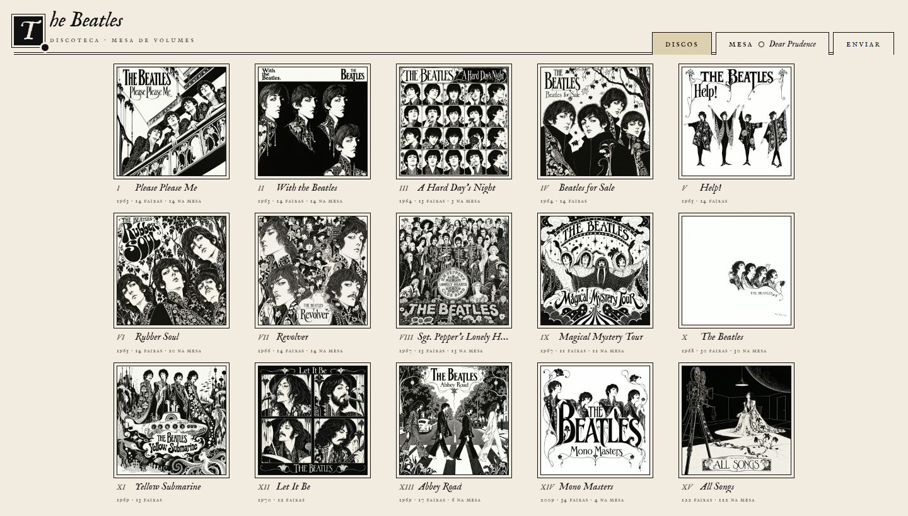
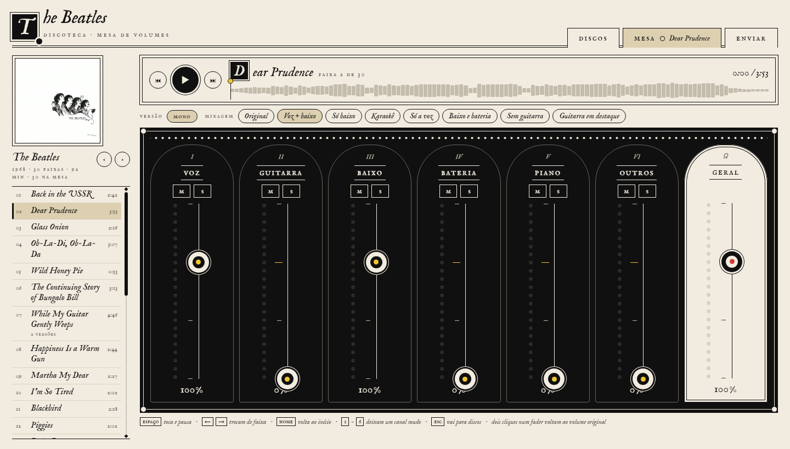
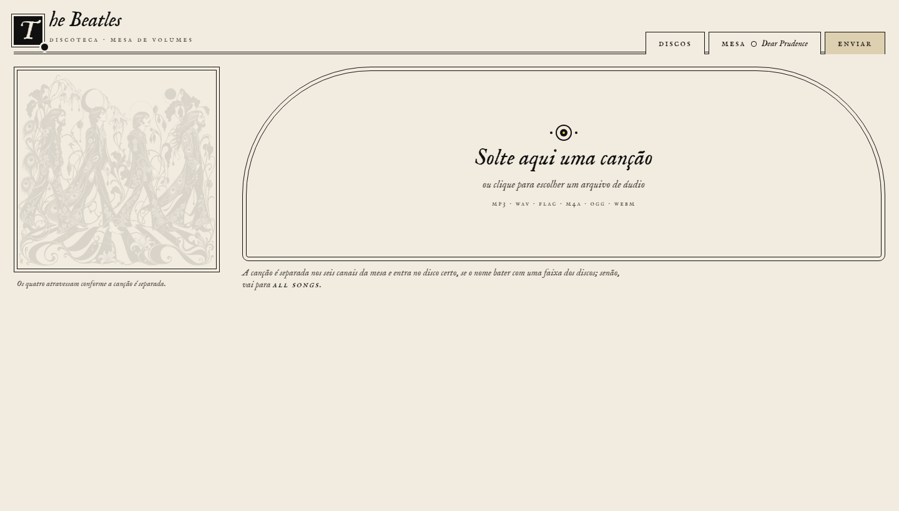

# Separador de faixas · Mesa de volumes

Separe qualquer música em **6 canais — voz, guitarra, baixo, bateria, piano e outros — com IA no seu próprio computador**,
e ouça numa mesa de volumes no navegador: suba o baixo, tire a voz, deixe só a linha de baixo com a voz.
Feito pensando nos Beatles (a estante tem os 14 discos), mas funciona com qualquer música.



> **Projeto pessoal de demonstração.** Sem suporte, issues ou pull requests — se quiser mudar algo, faça um fork (licença MIT).
> **Nenhuma música vem junto:** você usa os seus próprios arquivos de áudio, e tudo é processado no seu computador.

## O que tem

| Mesa | Enviar |
|---|---|
|  |  |

- **Mesa**: 6 canais + geral, mudo/solo, mixagens prontas ("Voz + baixo", "Só baixo", "Karaokê"…), medidores,
  troca de versão por faixa e **passagem sem lacuna** entre faixas do mesmo disco.
- **Enviar**: solte um arquivo de áudio; a separação roda no seu PC, com progresso real, e a música entra no disco
  certo (se o nome bater com uma faixa) ou em **All Songs**. Copiar arquivos para a pasta `dados/musicas/` também funciona.
- **Discos**: os 14 álbuns com todas as faixas; as que você já separou acendem.

## Instalar

**Requisitos:** Windows 10/11 · Python 3.10+ (recomendado 3.12) · [ffmpeg](https://ffmpeg.org) ·
placa de vídeo **opcional**: NVIDIA (CUDA) ou AMD/Intel (DirectML); sem ela funciona pela CPU, bem mais devagar.

O instalador mostra **o que vai baixar e o tamanho, e pede sua confirmação** antes:
PyTorch com CUDA ~2,5 GB (DirectML: ~250 MB; só CPU: ~200 MB) · bibliotecas ~300 MB · 2 modelos de IA ~1,3 GB.
Tudo fica dentro da pasta do projeto — para desinstalar, apague a pasta.

### Com um agente de IA
Abra o Claude Code, Codex, GitHub Copilot (ou outro agente) **nesta pasta** e peça: *"instale e abra a mesa"*.
O [`AGENTS.md`](AGENTS.md) tem o roteiro completo; o agente diagnostica sua máquina e pede seu OK antes de baixar.

### À mão
```bat
git clone https://github.com/andredias77/separador-de-faixas.git
cd separador-de-faixas
python verificar.py      &REM o que já está pronto e o que falta
instalar.bat             &REM pergunta antes de baixar; instala tudo dentro da pasta
iniciar.bat              &REM abre a mesa em http://127.0.0.1:8765/
```

## Quanto demora
Por música de ~3 min: **~2–7 min com placa NVIDIA** (medido numa GTX 1650 e numa T4) e **dezenas de minutos só com CPU**.
Com placa AMD ou Intel (DirectML, experimental) fica entre os dois, dependendo da placa.
Você pode fechar a página durante a separação; o servidor continua e a página mostra o andamento quando você volta.

## Como funciona a separação
Três passadas de modelos [BS-Roformer](https://arxiv.org/abs/2309.02612), via [audio-separator](https://github.com/nomadkaraoke/python-audio-separator):

1. **Voz** = média da voz de dois modelos (BS-Roformer-SW e BS-Roformer Viperx 1297);
2. **instrumental** = música − voz;
3. o **BS-Roformer-SW** separa o instrumental em guitarra, baixo, bateria, piano e outros.

A escolha veio de uma avaliação objetiva (pasta [`avaliacao/`](avaliacao/)), em trechos do MUSDB18 convertidos para
mono (como os discos mono dos Beatles). SDR, maior é melhor:

| | Voz | Baixo | Baixo vazando p/ outras faixas |
|---|---|---|---|
| Versão anterior (MelBand Kim → SW) | 10,9 dB | 9,1 dB | 8,5% |
| **Atual (SW + Viperx → SW)** | **12,3 dB** | **9,3 dB** | **7,8%** |

## Pastas
```
instalar.bat · iniciar.bat · instalar.py · verificar.py   instalação, atalhos e diagnóstico
mesa/          a página (index.html · mesa.css · mesa.js · imagens/), sem dependências
separador/     servidor.py (servidor local) · separar.py (separação em 6 faixas) · catalogo.py + discos.json (estante)
avaliacao/     avaliação (SDR) e otimização que escolheram a técnica
ferramentas/   infraestrutura pessoal do autor (fila em duas máquinas, Colab) — não é necessária
docs/          imagens deste README
dados/         fora do git: musicas/ (seus arquivos) · faixas/ (separadas) · modelos/ · registros/
```

## Créditos e direitos
- Modelos: **BS-Roformer-SW** (jarredou) e **BS-Roformer Viperx 1297** (viperx), baixados pelo audio-separator;
  cada modelo tem sua própria licença — consulte antes de qualquer uso além do pessoal.
- Ilustrações das capas e das figuras: arte própria no estilo de Aubrey Beardsley. Gravuras originais de Beardsley:
  domínio público (Wikimedia Commons).
- Este repositório não contém nem distribui nenhuma gravação. Respeite os direitos das músicas que você usar.
- Código: [MIT](LICENSE).

---

**English summary.** Split any song into 6 stems (vocals, guitar, bass, drums, piano, other) with BS-Roformer models
running locally, and play them in a browser mixing desk with per-stem volume, mute/solo and gapless playback.
Windows, Python 3.10+, ffmpeg; GPU optional (NVIDIA via CUDA, AMD/Intel via DirectML). Open an AI coding agent in this folder and ask it to install —
see [`AGENTS.md`](AGENTS.md). No music is included. Personal showcase project: no support, issues or PRs; fork freely (MIT).
